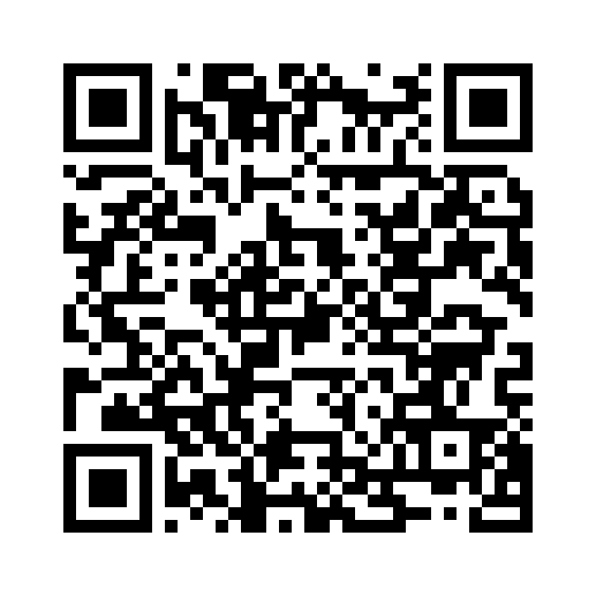

# Computational Perception Labs

All eight labs of the course on one page. Each lab has three tabs:

- **Content**: the lab sheet, with its examples, exercises and project.
- **Project code**: the lab's project as one finished program, to copy or download, with examples of its real output.
- **Quiz**: the lab's own click-only quiz, with no sign-in, and one score card per lab.

Prepared by Dr. Ahmed M. AbdAl-Montalib.

**Student link: https://ahmedabdalmontalib.github.io/computational-perception-labs/**

## Put it on GitHub Pages

1. Create a public repository on GitHub, for example `computational-perception-labs`.
2. Press **Add file → Upload files**, drop in all the files of this folder (`index.html`, `sw.js`, `manifest.webmanifest`, the three icons and this `README.md`), and press **Commit changes**.
3. Open **Settings → Pages**. Under **Build and deployment**, set **Source** to *Deploy from a branch*, choose the branch **main** and the folder **/ (root)**, and press **Save**.
4. After a minute or two, the page shows the address, such as `https://<your-user-name>.github.io/computational-perception-labs/`. Give this address to the students.

A link to the file itself (`github.com/.../index.html`) shows its code, not the site: always give the students the `github.io` address.

## Add the lab files of Labs 4 to 8

Labs 4 to 8 use a trained network and a video or photo. Three of the five zip files are larger than the 25 MB that GitHub's upload page accepts, so they go into a release, which takes files of any size used here.

1. In the repository, open **Releases → Draft a new release** (on the right of the main page).
2. Under **Choose a tag**, type exactly `files` and choose **Create new tag**. Give it the title `Lab files`.
3. Drop in the five files of the folder `upload-to-releases`: `Lab04-files.zip` to `Lab08-files.zip`.
4. Press **Publish release**.

The download buttons of the site find these files by themselves, from the address of the page. Check one button after publishing.

## Good to know

- Each student's answers stay in their own browser. Nothing is sent anywhere, and the page does not collect scores.
- **Clear my answers for this lab** starts a quiz again from nothing, for shared computers.
- After the first visit, the sheets, the programs and the quizzes also work without internet.
- The answer keys of the labs are not on this site, and must not be uploaded.
